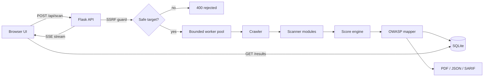

# VulnScan Pro

[](https://github.com/reeshitakate01/VulnScan-Pro/actions/workflows/ci.yml)


> A web application vulnerability scanner with a live scanning dashboard,
> OWASP Top-10 mapping, an A–F security score, and PDF / JSON / SARIF reports.

You enter a target URL, pick the checks you want, and VulnScan Pro crawls the
site and runs a battery of scanner modules in the background — streaming
progress to the browser in real time — then grades the target and produces a
shareable report.

> ⚠️ **Authorised testing only.** Scan systems you own or have explicit, written
> permission to test. See [Responsible use](#responsible-use).

---

## Features

**15 scanner modules**

| Area | Modules |
|------|---------|
| Network | Port scan, WAF/CDN detection |
| Transport | SSL/TLS configuration, HSTS |
| HTTP posture | Security headers, cookies, **CORS misconfig**, **HTTP methods / TRACE (XST)** |
| Content | Crawler, tech fingerprinting, JavaScript secret analysis |
| Injection | Reflected XSS, SQL injection (error / blind-time / boolean) |
| Logic | Open redirect, CSRF |
| Recon | DNS recon (SPF/DMARC/DKIM, zone transfer), **security.txt** |

**Beyond the scanners**

- **SSRF-safe by design** — refuses to scan private / loopback / link-local /
  reserved hosts (e.g. cloud metadata at `169.254.169.254`) unless you
  explicitly opt in. A security tool that can't be turned against internal
  infrastructure.
- **Live CVE lookup** via [OSV.dev](https://osv.dev) for detected client-side
  libraries, with an offline fallback table.
- **OWASP Top-10 + CWE + CVSS** enrichment for every finding.
- **Weighted A–F score** with a severity breakdown and interactive charts.
- **User accounts** (register / login) with **per-user scan history** and a
  **score-trend chart** over time; **rate-limited** auth and scan endpoints.
- **Exports:** PDF (executive report), JSON (programmatic), and
  **SARIF 2.1.0** (ingestible by GitHub code scanning / CI).
- **Notifications:** optional Slack webhook and email delivery.
- Runs fully in **Docker** (gunicorn), tested in **CI**, configured entirely
  via env vars.

---

## Architecture



- **Backend:** Flask + SQLAlchemy (SQLite). Scans run in a bounded background
  worker pool; progress is pushed to the UI over Server-Sent Events.
- **Frontend:** vanilla JS + Chart.js, no build step.
- **Config:** everything is environment-driven (see [Configuration](#configuration)).

---

## Quickstart

### Option A — Docker (recommended)

```bash
git clone https://github.com/reeshitakate01/VulnScan-Pro.git
cd VulnScan-Pro
docker compose up --build
# open http://localhost:5000
```

### Option B — Local Python

```bash
git clone https://github.com/reeshitakate01/VulnScan-Pro.git
cd VulnScan-Pro
python -m venv venv
source venv/bin/activate          # Windows: venv\Scripts\activate
pip install -r requirements.txt
cp .env.example .env              # optional: tweak settings
cd backend && python app.py
# open http://127.0.0.1:5000
```

No C/C++ build tools are required.

---

## Configuration

All settings are read from environment variables (or a `.env` file). See
[`.env.example`](.env.example).

| Variable | Default | Description |
|----------|---------|-------------|
| `FLASK_DEBUG` | `0` | Enable Flask debug (**keep off** in production). |
| `SAFE_MODE` | `1` | SSRF guard: block internal/reserved targets. |
| `SAFE_MODE_ALLOW` | — | Comma-separated hosts allowed despite `SAFE_MODE` (e.g. a lab host). |
| `MAX_CONCURRENT_SCANS` | `3` | Bounded worker pool size. |
| `SCAN_MAX_DURATION` | `600` | Hard per-scan time ceiling (seconds). |
| `HTTP_TIMEOUT` | `8` | Default outbound request timeout. |
| `OSV_ENABLED` | `1` | Query OSV.dev for live CVEs. |
| `CORS_ORIGINS` | — | Comma-separated allowlist to enable cross-origin API access (off by default). |
| `RATELIMIT_STORAGE_URI` | `memory://` | Rate-limit backend (point at Redis to scale out). |
| `SECRET_KEY` | dev key | Flask secret — set a real value in production. |
| `SMTP_*` | localhost:1025 | Email notification settings. |

---

## Usage

### Web UI
On first run, open the app and **create an account** (register, then log in).
Enter a URL, choose modules, confirm authorisation, and watch the live
execution log. When the scan completes you're taken to a dashboard with the
score, severity breakdown, detailed findings, per-module view and OWASP mapping.
Your past scans and a score-trend chart live under **History**.

### API

| Method | Endpoint | Purpose |
|--------|----------|---------|
| `POST` | `/api/scan` | Start a scan `{url, modules, webhook_url?, email?}`. |
| `POST` | `/api/estimate` | Estimate scan duration for selected modules. |
| `GET`  | `/api/scan/<id>/stream` | SSE progress stream. |
| `GET`  | `/api/scan/<id>/results` | Full results JSON. |
| `GET`  | `/api/report/<id>` | PDF report. |
| `GET`  | `/api/report/<id>/json` | Structured JSON export. |
| `GET`  | `/api/report/<id>/sarif` | SARIF 2.1.0 export. |

The SARIF output can be uploaded to GitHub code scanning to turn a scan into
pull-request annotations.

---

## Testing

```bash
pip install -r requirements-dev.txt
pytest          # unit + API tests
ruff check .    # lint
```

CI runs both on every push and pull request.

---

## Security

The scanner's own attack surface has been self-audited — see
[`docs/SECURITY_REVIEW.md`](docs/SECURITY_REVIEW.md) for the full write-up
(SSRF guard, CORS, non-destructive payloads, path handling, and more).

## Responsible use

VulnScan Pro performs active security testing, including sending injection
probes to the target. **Only scan systems you own or are explicitly authorised
to test.** Unauthorised scanning may be illegal. `SAFE_MODE` is on by default to
prevent the tool being pointed at internal infrastructure. A deliberately
vulnerable demo app is included under [`vulnerable-webapp/`](vulnerable-webapp/)
so you can exercise every module safely on your own machine.

---

## Roadmap

- Scheduled / recurring scans
- Authenticated scanning (inject a target session/cookie to scan behind login)
- Async engine (httpx + asyncio) for higher throughput
- More modules: subdomain takeover, directory brute-force, clickjacking PoC

---

## License

[MIT](LICENSE) © 2026
